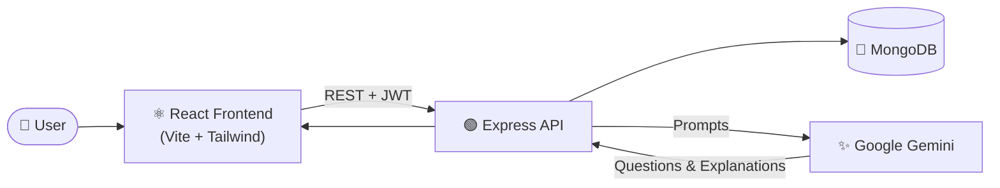

# AI Interview Prep

AI Interview Prep is a full-stack web application that helps candidates prepare for technical interviews with AI-generated questions, answer explanations, and session tracking. The platform combines a React frontend with a Node.js/Express backend and MongoDB data layer to deliver a smooth interview-practice experience.

## Project Overview

This project is designed for job seekers who want a smarter way to practice technical interviews. It allows users to:

- create interview sessions based on their target role and experience
- generate role-specific interview questions using AI
- review detailed answers for each question
- pin important questions and save personal notes
- revisit previous sessions and continue preparing over time

The app is built to be practical, clean, and easy to extend as a real-world interview preparation product.

## Tech Stack

### Frontend
- React
- Vite
- React Router
- Axios
- Tailwind CSS
- Framer Motion
- React Hot Toast
- React Icons
- React Markdown

### Backend
- Node.js
- Express.js
- MongoDB with Mongoose
- JWT authentication
- Multer for file uploads
- CORS for cross-origin support
- dotenv for environment configuration

### AI Integration
- Google Gemini via the Google GenAI SDK

### Tools and Workflow
- Git for version control
- npm for package management
- Nodemon for backend development hot reload

## Architecture

The project follows a simple modular full-stack structure:

- Frontend: handles landing, authentication, dashboard, and interview sessions
- Backend: exposes protected API routes for auth, sessions, questions, and AI generation
- Database: stores user data, sessions, and generated interview questions
- AI layer: generates custom mock interviews and concept explanations based on user input

## Core Features

### 1. User Authentication
Users can sign up and log in securely using JWT-based authentication. Protected routes ensure that session data remains private to each user.

### 2. Interview Session Creation
Users can define:
- target role
- required experience level
- focus topics
- number of questions
- brief session description

The app sends this data to the backend and creates a new interview session.

### 3. AI-Generated Questions
The backend connects to Gemini AI to generate interview questions based on the user’s goals and focus areas. This makes the experience more personalized than static question banks.

### 4. Answer Review and Explanation
Each question includes a model answer. Users can also ask for deeper explanations of concepts so they can learn the reasoning behind responses, not just memorize them.

### 5. Session Notes and Pinning
Users can:
- pin high-priority questions
- add custom notes to each question
- revisit their prep sessions later

### 6. Personalized Dashboard
The dashboard shows a user’s interview history and helps them organize future preparation.

## Project Structure

```bash
AI-Interview-Prep/
├── backend/
│   ├── config/
│   ├── controllers/
│   ├── middleware/
│   ├── models/
│   ├── routes/
│   ├── uploads/
│   ├── utils/
│   ├── .env
│   ├── package.json
│   └── server.js
├── frontend/
│   └── AI-Interview-Prep/
│       ├── public/
│       ├── src/
│       ├── package.json
│       ├── vite.config.js
│       └── index.html
├── README.md
└── LICENSE
```

## 🏗️ Architecture
 


## Getting Started

### Prerequisites

Make sure you have installed:

- Node.js (v18 or above recommended)
- npm
- MongoDB running locally or using MongoDB Atlas
- A valid Google Gemini API key

### 1. Clone the repository

```bash
git clone <repository-url>
cd AI-Interview-Prep
```

### 2. Configure the backend environment

Create a `.env` file inside the `backend` folder with the following values:

```env
PORT=5000
MONGO_URL=mongodb://127.0.0.1:27017/ai-interview-prep
JWT_SECRET=your_jwt_secret
GEMINI_API_KEY=your_google_gemini_api_key
```

### 3. Install backend dependencies

```bash
cd backend
npm install
```

### 4. Install frontend dependencies

```bash
cd ../frontend/AI-Interview-Prep
npm install
```

### 5. Run the backend

```bash
cd backend
npm run dev
```

### 6. Run the frontend

```bash
cd frontend/AI-Interview-Prep
npm run dev
```

Then open the local Vite URL in your browser, usually:

```bash
http://localhost:5173
```

## Environment Notes

- The backend uses MongoDB for persistent storage.
- Authentication tokens are issued using JWT.
- AI-based question generation requires a valid Gemini API key.
- Uploaded profile images are stored in the backend `uploads` folder and served publicly.

## Typical User Flow

1. User signs up or logs in
2. User visits the dashboard
3. User creates an interview session with role and topic preferences
4. AI generates mock interview questions
5. User reviews the answers and explanations
6. User saves notes and pins important questions
7. User revisits the same session for continued practice

## Future Enhancements

### Short-Term Improvements
- add score tracking and performance analytics
- implement user profile editing and avatar updates
- add a real-time interview mode with timer and voice input
- improve AI answer quality and context-aware question generation

### Medium-Term Features
- add mock coding interview challenges
- create a leaderboard and achievements system
- support saved resume parsing for personalized questions
- add multi-language interview preparation capabilities

### Long-Term Vision
- integrate live video interview coaching
- add speech recognition and feedback on delivery quality
- provide adaptive learning paths based on user weaknesses
- turn the app into a full AI-powered career preparation platform

## Security Considerations

- JWT tokens should be stored securely in production
- API keys should never be exposed in the frontend
- file upload validation should remain strict in production
- access control should always verify session ownership before modifying user resources

## Contribution

Contributions are welcome. If you want to improve the app, consider:

- fixing UI/UX flaws
- improving backend validations
- expanding AI prompts and answer quality
- adding new interview features and analytics

## License

This project is licensed under the MIT License unless otherwise specified in the repository.

## Final Note

AI Interview Prep is a practical, scalable project that demonstrates how AI can enhance career preparation. It combines modern frontend UX, secure backend APIs, and powerful AI-driven question generation into one focused product. With clean architecture and room for expansion, it is well-suited for learning, demos, and future product growth.
